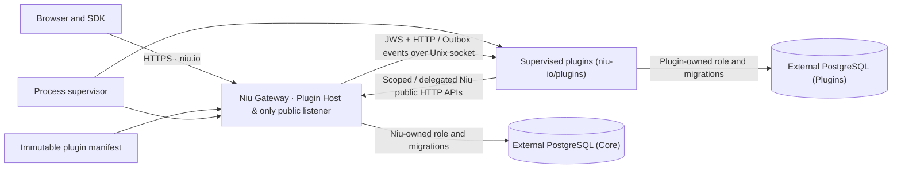

# Plugin composition, Cloud SaaS, and Enterprise distributions

Status: target architecture. This document is the public contract for Niu's Plugin Host boundary and its composed commercial distributions (`niu-io/cloud` and `niu-io/enterprise`). It distinguishes target post-refactor plugin capabilities from the transitional V1 slice currently shipped by the community runtime.

## Decision

Unify both open-source and commercial/enterprise extensions under one **Plugin** model. The open-source `niu-io/niu` repository owns the **Plugin Host** runtime, the public `plugin-api` and `plugin-sdk` crates, the process supervisor, and built-in open-source plugins (`niu/plugins/*`) that community deployments can enable out of the box. The private `niu-io/plugins` source repository owns closed-source commercial and enterprise plugins built against `niu`'s `plugin-sdk`. Dedicated distribution repositories (`niu-io/cloud` for the hosted `niu.io` SaaS service, and `niu-io/enterprise` for customer-managed self-hosted Enterprise deployments) assemble pinned commits from those source repositories into deployable images.

Keep one public HTTP listener—and on the hosted service, one product domain, `niu.io`. The Niu Gateway acts as the **Plugin Host**: it owns public ingress, authentication, the public route table, admission control, and the authoritative financial ledgers. Plugins are registered at build time (or selected from built-in open-source plugins) in an immutable manifest and may combine in-process data-plane hooks with supervised out-of-process HTTP/event services behind private Unix sockets and their own PostgreSQL role/schema.

At startup, the Gateway validates the manifest and checks declared plugin services' health. It does not discover arbitrary files, accept service self-registration, download plugins at runtime, or hot-load untrusted code. This preserves process and repository isolation while avoiding a dynamic plugin marketplace or cluster service-discovery control plane that the single-image deployment does not need.

## Source and distribution repository ownership

Repository responsibilities are split into **source repositories** (where code is written and tested) and **distribution repositories** (which contain no business source code and assemble pinned commits into deployable images):

1. **`niu-io/niu` (Open-source core and public plugins source):** Owns the independently buildable open-source platform: Gateway, core data plane, public control APIs, dashboard shell, documentation, model catalog, public contracts, community image, the neutral Plugin Host runtime, `crates/plugin-api`, `crates/plugin-sdk`, the process supervisor, and built-in open-source plugins under `plugins/` (such as basic OAuth, standard Provider adapters, and basic webhook exporters). Community users can enable built-in open-source plugins directly when starting Niu without any private checkout.
2. **`niu-io/website` (Marketing website source):** Owns the marketing homepage, product comparisons, and marketing assets.
3. **`niu-io/plugins` (Private commercial and enterprise plugin source):** Owns closed-source commercial and enterprise **Plugins** that monetize the hosted SaaS service and self-hosted Enterprise edition. Every plugin in `niu-io/plugins` is organized vertically by feature under `plugins/<plugin-id>/` and builds against the public `plugin-api` and `plugin-sdk` from a tagged `niu-io/niu` release. `niu-io/plugins` is versioned with semantic version Git tags (`vX.Y.Z`) and is never deployed directly.
4. **`niu-io/cloud` (`niu.io` SaaS distribution):** Owns the production release composition and deployment configuration for the hosted `niu.io` SaaS service. It pins `niu-io/niu` and `niu-io/plugins` by both semantic version Git tag (`vX.Y.Z`) and immutable 40-character commit SHA alongside `niu-io/website` in `release-pins.json`, verified at build time before assembling the image.
5. **`niu-io/enterprise` (Self-hosted Enterprise distribution):** Owns the release composition and delivery templates (Compose / Helm / offline upgrade tooling) for large enterprise customers running Niu on-premises. It pins `niu-io/niu` and `niu-io/plugins` by both semantic version Git tag (`vX.Y.Z`) and immutable 40-character commit SHA (without `niu-io/website`) and builds an image containing only customer-deployed enterprise plugins and license enforcement. `niu.io`-confidential SaaS plugins (such as domestic tax invoicing, Provider revenue-sharing settlement, and proprietary supply-margin probing) are physically excluded from the `niu-io/enterprise` build.

The public Niu repository owns the stable integration contracts and `plugin-sdk`. Private plugins implement those contracts and use clients generated from them; they do not maintain a forked copy of the Niu core, import private gateway internals, or query Niu core database tables directly.

## Unified Plugin model and capability facets

Real product and enterprise features frequently span the inference hot path, background control-plane APIs, database state, and management UI. Treating hooks, adapters, and backend services as separate top-level concepts fragments a single feature across multiple trees. Instead, every open-source plugin in `niu-io/niu/plugins/` and every closed-source plugin in `niu-io/plugins/plugins/` is packaged as a cohesive **Plugin** (`plugins/<plugin-id>/`) that declares one or more of four capability facets in its manifest:

1. **Data-plane Hooks and Adapters (`hooks`):** Typed extensions invoked on the request/authentication path (evolving [`crates/extension-api`](../../crates/extension-api/src/lib.rs)):
   - `IdentityFederation`: Maps authenticated OIDC, SAML 2.0, WeCom, Feishu, or DingTalk assertions into verified identity claims and group memberships.
   - `PolicyHook`: Evaluates request/response content for guardrails, enterprise DLP redaction, or external compliance gateways under a cryptographic `PolicyBinding`.
   - `ProviderAdapter` and `PaymentAdapter`: Encodes and normalizes model protocols and payment/settlement channels.
   - `RouteSelector`: Reorders eligible route candidates using priority/weight, SLA telemetry, customer tier, or hosted supply-margin protection rules while the core rechecks all hard grants and budget bounds.
2. **Asynchronous Event Observers (`observers`):** Consumers of immutable core events delivered through a transactional outbox (`MeteringObserver` and platform audit streams), acknowledging each stable `event_id` idempotently without mutating authoritative core ledgers.
3. **Supervised HTTP Service Routes (`routes`):** Out-of-process HTTP endpoints listening on a private Unix socket (`/run/niu/plugins/{plugin_id}.sock`, transitional `/run/niu/modules/{module_id}.sock`) and exposed by the Gateway under `/api/plugins/v1/{plugin_id}/…` (transitional `/enterprise/api/v1/{module_id}/…`), backed by the plugin's own PostgreSQL role and migrations.
4. **Dashboard UI Contributions (`ui`):** Build-time frontend routes, Admin sidebar sections, and global Settings tabs compiled into the dashboard bundle.

### Open-source vs. closed-source plugin matrix

Shipping built-in open-source plugins in `niu-io/niu/plugins/` validates the Plugin Host contract continuously in public CI while establishing a clear open-core tiering boundary against `niu-io/plugins`:

| Plugin (`plugins/<id>`) | Repository | Capability facets used | Community (`niu`) | `niu-io/cloud` (`niu.io` SaaS) | `niu-io/enterprise` (Self-hosted) | Purpose |
| --- | --- | --- | :---: | :---: | :---: | --- |
| Built-in open-source plugins (e.g., `oauth-basic`, `webhook-exporter`, standard adapters) | `niu-io/niu` (Public) | `hooks` / `observers` / `ui` | Selectable | Selectable | Selectable | Standard single-tenant OAuth, basic webhook event delivery, and public Provider/Guardrail integrations |
| `sso-scim` | `niu-io/plugins` (Private) | `IdentityFederation` + `routes` (OAuth/SAML callbacks, SCIM 2.0 sync) + PG schema + `ui` | — | Enabled | Enabled | Multi-tenant enterprise SSO (OIDC/SAML/WeCom/Feishu/DingTalk) and automated SCIM 2.0 directory sync |
| `governance` | `niu-io/plugins` (Private) | `routes` + `observers` + PG schema + `ui` | — | Enabled | Enabled | Cross-workspace cost centers, chargeback reporting, and multi-stage budget/policy approval workflows |
| `compliance` | `niu-io/plugins` (Private) | `PolicyHook` + `observers` + `routes` + PG schema + `ui` | — | Enabled | Enabled | Real-time PII/DLP redaction, long-term encrypted audit retention, and SIEM streaming export (SLS, CLS, Splunk, Kafka) |
| `proprietary-providers` | `niu-io/plugins` (Private) | `ProviderAdapter` + optional `routes`/`ui` | — | Enabled | Enabled | Dedicated government-cloud, private-signature, and specialized commercial multimodal Provider adapters |
| `commercial` | `niu-io/plugins` (Private) | `PaymentAdapter` + `observers` + `routes` + PG schema + `ui` | — | **Enabled** | Excluded | Customer KYB verification, domestic VAT e-invoicing (Fapiao), contract discounts/promotional grants, and Provider payout reconciliation |
| `supply-intelligence` | `niu-io/plugins` (Private) | `RouteSelector` + `routes` + PG schema + `ui` (Admin only) | — | **Enabled** | Excluded | Active upstream SLA probing, procurement-vs-retail margin protection, and automated route cooldowns |
| `license` | `niu-io/plugins` (Private) | Startup/admission guard + `routes` + `ui` | — | Excluded | **Enabled** | Offline-signed enterprise license validation, expiry, and workspace/seat capacity bounds |

## One product domain and runtime shape

On the hosted `niu-io/cloud` service, all browser, API, and inference traffic uses `niu.io`. The homepage is at `/`, documentation at `/docs/`, model catalog at `/models/`, the dashboard at `/workspaces/{workspace}/…`, public APIs at `/v1/` and `/admin/v1/`, and plugin HTTP APIs under `/api/plugins/v1/{plugin_id}/…` (transitional `/enterprise/api/v1/{module_id}/…`). There is no separate application subdomain.

Repository boundaries do not create separate domains. The Gateway serves a separately built website artifact through `NIU_SITE_DIR` at `/`, `/site-assets/`, and `/_astro/`, plus `favicon.ico`, `robots.txt`, and `sitemap.xml`. Niu owns `/models/`, `/catalog-assets/`, and `/_catalog/` through `NIU_CATALOG_DIR`; documentation and dashboard artifacts keep their own directories. The website artifact cannot override these product routes or API namespaces. Without `NIU_SITE_DIR` (both in community builds and in `niu-io/enterprise` self-hosted builds), the root redirects to `/workspaces/default/` and builds without a website checkout. See [repository ownership](repository-ownership.md).

Each composed distribution image contains one pinned Niu Gateway, the supervisor, and only the plugins declared for that distribution. Only the Gateway binds the public listener. The supervisor starts each out-of-process plugin with a private Unix socket. PostgreSQL is an external persistent data service; no database process or data directory belongs in the application image.

The two database labels may be separate databases or separately permissioned schemas on one managed PostgreSQL service. Each side owns its migrations and database role. Plugins do not query or mutate Niu core tables directly. Replacing the application image does not erase either database.

## Registration, discovery, and loading

Plugins are trusted build-time release components, not user-uploaded runtime code. Each distribution build (`cloud` or `enterprise`) contains one immutable manifest conforming to [`release-manifest.v1.schema.json`](../../contracts/enterprise/release-manifest.v1.schema.json) (and its planned unified plugin-manifest successor). The manifest pins the exact Niu commit and lists each plugin's ID, version, supported contract range, required/optional status, capability facets, private socket, HTTP route prefixes, allowed methods, authentication/permission mode, request/response size limits, and deadline. It cannot choose an arbitrary executable, public bind address, or unverified file to load.

The runtime uses static composition:

1. The distribution build (`niu-io/cloud` or `niu-io/enterprise`) pins full `niu` and `plugins` commits (plus `website` for `cloud`), installs the manifest, and configures the supervisor with the matching plugin binaries. The supervisor configuration maps each manifest plugin ID to a fixed executable and private socket. CI rejects any mismatch between those release artifacts.
2. The supervisor starts only those configured processes. The Gateway reads and validates the manifest at startup: contract version, core compatibility, unique plugin IDs, route ownership, route namespace, limits, and socket paths.
3. The Gateway checks liveness and readiness through each declared private socket. It builds its static route and hook registries from the validated manifest. A request to an unhealthy plugin service receives 503; readiness reflects current health, so recovered services can serve requests again. Combined distribution readiness returns 503 if the core database or a required plugin is unavailable (within a three-second deadline); the core `/readyz` remains based on Niu-owned requirements so a non-core plugin failure does not remove healthy core inference routes from service.
4. Route changes and plugin upgrades require a new immutable distribution image and process restart. There is no service self-registration, runtime code download, directory scan, dynamic library loading, or hot reload.

The HTTP health protocol is described in [`module-service.v1.openapi.yaml`](../../contracts/enterprise/module-service.v1.openapi.yaml). Unix socket ownership and filesystem permissions restrict which processes can connect; no public control credential or separate control API is needed.

For operator-authenticated routes, the Gateway authenticates the caller, authorizes the declared permission and tenant scope, removes all client-supplied `X-Niu-*` and `X-Forwarded-*` headers, then replaces `Authorization` with a short-lived Gateway-signed compact JWS bearer token. It forwards only the documented content-negotiation and idempotency headers; plugins use signed claims exclusively for actor, permission, and tenant scope. It applies Niu's operator-role matrix: `read` is available to owner/admin/viewer, `write` to owner/admin, and `manage_operators` to owner only. The JWS payload follows [`module-request-context.v1.schema.json`](../../contracts/enterprise/module-request-context.v1.schema.json), uses EdDSA, sets `aud` to exactly the target plugin ID, and binds the actor, effective organization/project scope, permission, method, full request target (path and query), request ID, body digest, and expiry (at most 60 seconds). Its protected header contains a `kid`. The distribution supplies the Gateway's base64url Ed25519 seed and key ID as runtime secrets; plugins receive only a JSON JWK set containing verification keys, which allows overlapping key rotation. The plugin validates the signature and still enforces resource ownership in its own database. Installation-wide bootstrap credentials and the user's raw bearer token are never forwarded.

The Gateway's route matcher requires a path-segment boundary and checks the HTTP method. Manifest validation rejects overlapping prefixes and collisions with Niu-owned routes.

## Platform-to-Plugin and Plugin-to-Platform boundaries

The Gateway is the only public ingress. It proxies a request only to the plugin whose manifest entry owns the route, enforcing request/response size bounds and deadlines and marking authenticated responses `Cache-Control: no-store`. The Gateway does not retry plugin HTTP requests; plugins implement idempotency for mutations that clients may safely retry. An unmatched path returns 404, a disallowed method returns 405, and an unavailable service returns 503 without falling through to another plugin or a core handler.

The signed context is evidence of the caller and effective tenant scope, not an authorization bypass. A plugin cannot expand its own permissions, tenant scope, model grants, budget, credential access, attempt state, or revocation decisions. Niu remains authoritative for platform-owned policy and accounting.

When plugins call back into Niu platform features, they use the public HTTP/OpenAPI contracts shipped with their pinned Niu commit:

- Model operations (such as active supply probing) use an explicitly scoped Niu API credential so the core applies standard admission controls, routing, attempt recording, and canonical usage/cost accounting.
- Tenant and platform administration use scoped operator or delegated credentials rather than forwarding a user's raw bearer token or sharing an unrestricted installation bootstrap secret.

## Target Plugin Host capabilities (post-API refactor)

While the core Niu API surface is undergoing refactoring, the following five Plugin Host capabilities are designated as the target openness boundary to be implemented once the core API stabilizes:

1. **Unified `plugin` naming and neutral route namespace:** Converge [`crates/extension-api`](../../crates/extension-api/src/lib.rs) and [`apps/gateway/src/enterprise/`](../../apps/gateway/src/enterprise/runtime.rs) under unified `plugin` terminology (`NIU_PLUGIN_MANIFEST_PATH`, `/run/niu/plugins/{plugin_id}.sock`, and neutral `/api/plugins/v1/{plugin_id}/…` routes) so neither `niu-io/niu` nor `niu-io/cloud` exposes misleading `/enterprise/` URLs for general SaaS workflows like invoicing.
2. **Gateway Hook Registry wiring:** Connect `IdentityFederation`, `PolicyHook`, `ProviderAdapter`, `PaymentAdapter`, and `RouteSelector` traits into the Gateway's live authentication, guardrail, routing, and dispatch paths.
3. **Expanded route authentication modes and streaming support:** Extend manifest route declarations beyond workspace `operator` sessions (`read`/`write`/`manage_operators`) to support:
   - `installation_admin`: Restricted to platform administrators (for `supply-intelligence` and platform-wide operations).
   - `workspace_key`: Authenticated by a workspace API key for SDK-accessible plugin endpoints.
   - `public_callback`: Unauthenticated ingress with Gateway size/rate bounds for external webhooks (OIDC/SAML callbacks, SCIM provisioning, tax-invoice/payment webhooks) verified by the target plugin.
   - Streaming response forwarding (`streaming: true`) for SSE streams and bounded compliance/report exports.
4. **Transactional Outbox delivery for `MeteringObserver` and audit streams:** Persist billing settlement and administrative audit events in a core outbox and deliver them over Unix sockets to subscribed plugins with idempotent `MeteringAck` receipts, eliminating any need for plugins to read core database tables.
5. **Delegated operator credentials and build-time UI slots:** Provide a signed delegated-credential contract so plugin-initiated `/admin/v1/…` mutations (such as KYB credit-limit approval or SCIM role sync) record the originating human or system actor in core audit logs; add `/enterprise/` / plugin SPA route fallback in [`static_site.rs`](../../apps/gateway/src/web/static_site.rs) and build-time navigation/settings slot registration in `apps/dashboard`.

## Compatibility, security, and release rules

Each distribution build (`niu-io/cloud` and `niu-io/enterprise`) pins full immutable Git commits for `niu` and `plugins` (plus `website` for `cloud`), never a moving branch or tag. Each plugin declares its plugin API version and supported Niu contract range. CI validates the manifest and supervisor mapping, checks the exact pinned core against public contract fixtures, and runs cross-process tests with the assembled distribution. The release records the `niu` commit, `plugins` commit, `website` commit (for `cloud`), enabled plugin IDs/versions, schema versions, and final image digest.

Distribution image allowlists exclude internal research, issue tracking, provenance archives, local reference checkouts, customer data, and secrets. Core and plugin migrations are independently versioned and tested with their respective database roles. A failed required plugin never causes core authorization, accounting, or policy checks to be skipped. Each schema upgrade has a documented recovery path.

## Comparison with established projects

No single project has the exact combination of a public Rust core, a shared private plugin monorepo, dual SaaS/on-prem distributions, one Gateway listener, and Unix-socket process isolation. These projects inform specific parts of the design:

| Project | Relevant pattern | What Niu takes from it | Why Niu does not copy it wholesale |
| --- | --- | --- | --- |
| [Grafana backend plugins](https://grafana.com/developers/plugin-tools/key-concepts/backend-plugins) | The server launches backend plugins as subprocesses and communicates over local IPC. | Unify extensions under the "Plugin" concept and use a process boundary to protect the host and isolate access to explicit interfaces. | Grafana's plugin RPC and SDK target third-party plugin marketplaces; Niu's plugins are build-time composed and expose ordinary versioned HTTP resources and typed hooks. |
| [Backstage backend system](https://backstage.io/docs/backend-system/architecture/index/) | A backend composes named plugins that bundle API routes, database migrations, and frontend views. | Package vertical business features (hooks + routes + DB schema + UI) together as self-contained plugins. | Backstage's TypeScript service container does not map directly to Niu's Rust Gateway or private Unix-socket boundary. |
| [OpenTelemetry Collector distributions](https://opentelemetry.io/docs/collector/extend/) | Custom distributions (`cloud`, `enterprise`) select components from a shared repository at build time. | Make `niu-io/cloud` and `niu-io/enterprise` immutable build-time compositions over `niu-io/niu` and `niu-io/plugins`. | OTel components are compiled into a single binary without out-of-process service isolation for stateful subsystems. |
| [Envoy external processing](https://www.envoyproxy.io/docs/envoy/latest/configuration/http/http_filters/ext_proc_filter) | A proxy calls an external processor through a typed protocol with explicit processing modes. | Keep Gateway-to-plugin calls bounded by an explicit protocol, timeout, and failure policy. | Envoy's streaming gRPC filter is a request-processing primitive, not a complete application plugin host or release system. |
| [LiteLLM proxy](https://github.com/BerriAI/litellm/blob/main/litellm/proxy/proxy_server.py) | Routers and hooks are assembled in one application process. | Organize routes and components in clear modules. | Unbounded in-process Python imports do not provide the repository, database-role, or crash isolation Niu requires for private services. |

## Implementation status

The Gateway currently implements the transitional V1 Unix-socket slice when `NIU_ENTERPRISE_MANIFEST_PATH` is set. Startup strictly parses and validates [`release-manifest.v1.schema.json`](../../contracts/enterprise/release-manifest.v1.schema.json) against the Gateway build commit (`NIU_CORE_GIT_COMMIT`) and API version (`NIU_CORE_API_VERSION`), rejects duplicate or overlapping routes and core-route collisions, and builds a static route registry under `/enterprise/api/v1/{module_id}/…`. Before forwarding, it checks the target service's liveness and readiness over `/run/niu/modules/{module_id}.sock`; unhealthy services return 503, and routes serve again when their service recovers. Requests require a scoped operator session and the route's declared permission; the Gateway replaces the incoming bearer with a short-lived EdDSA JWS (`NIU_ENTERPRISE_SIGNING_KEY` and `NIU_ENTERPRISE_SIGNING_KEY_ID`), forwards only approved request headers over the declared Unix socket, enforces request/response size limits and deadlines, and marks responses `Cache-Control: no-store`. `/enterprise/readyz` checks the core database and current required-service readiness within three seconds, while core `/readyz` remains independent. With the manifest unset, the community runtime remains unchanged and `/enterprise/readyz` reports `disabled`.

Convergence to the unified `NIU_PLUGIN_MANIFEST_PATH` contract, neutral `/api/plugins/v1/{plugin_id}/…` routes, multi-mode route authentication, outbox event delivery, and live Gateway hook wiring is scheduled after the ongoing core API refactoring completes.
