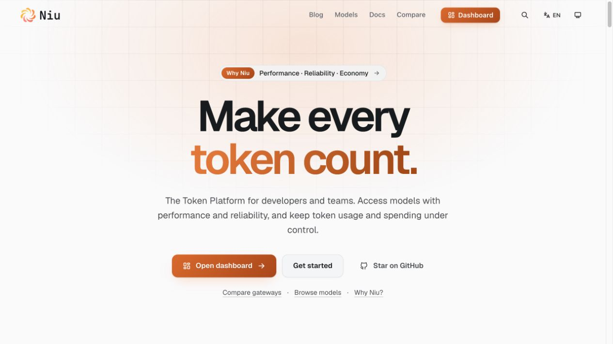
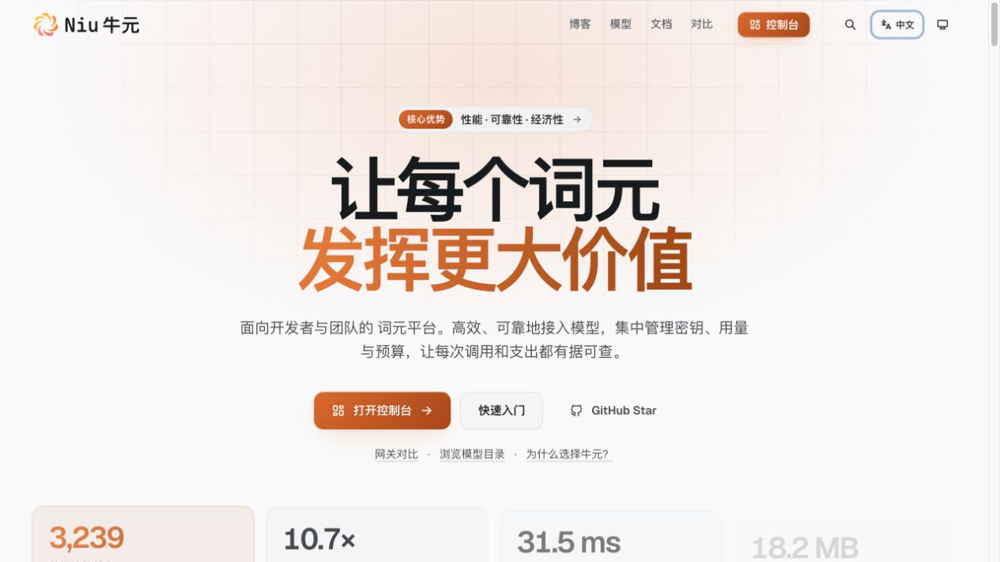

# Identity and landing positioning verification — October 30, 2026

Bead: `niu-fp6`. This record supersedes the earlier Bold lettering and website-only deployment evidence for the final identity selection.

## Released scope

Niu v0.2.28 (`e1b0063b3c168ad4fdaad9ea52717f833fc93ddc`) contains the approved title-case **Niu** in Maple Mono SemiBold 600, the existing warm seven-blade symbol and Open Huninn Chinese. Visible Latin bounds center at y=64.048 in the 128-unit symbol frame. Shared vector geometry drives components and exported artwork.

Website revision `043bb71ec38ede6d83f2a758b8444adfcebc5131` presents a Token Platform for developers and teams consuming model APIs. Its headline is **Make every token count.** Chinese uses 词元 and the two-line headline 让每个词元 / 发挥更大价值 without a comma. Performance, reliability and economy are explained through supported model access, request evidence and spending controls; no universal savings claim is made.

Marketing top navigation contains Blog, Models, Docs and Compare. API and SDK references remain available inside Docs and the footer. Navigation labels use Docs. Marketing navigation follows the 1184px content container; Docs retains its full-width shell.

## Verification evidence

- The clean release checkout passed 67 relevant frontend tests, dashboard TypeScript checks and production builds for dashboard, Docs and catalog. The 79-asset brand verification and 87-file archive checks passed.
- Website Astro checks reported zero errors, warnings or hints; production build, snapshot integrity and two publication tests passed.
- Render reported the composed release live at 08:20:27 UTC. Deployment readiness, public catalog, OpenAPI and password-login configuration checks passed.
- Live HTML for `/`, `/docs/` and `/models/` contains the approved 600 glyph path. The live `/login` component exposes that same path and a Docs resource link. Root and Docs favicons have matching expected bytes.
- Actual browser inspection covered English and Chinese, light and dark landing states, open mobile navigation, consumer preview switching, Docs EN/ZH branding, catalog navigation and the public login form. No authenticated customer data or inference writes were used.

At a 1920px viewport (1905px client width), marketing navigation and hero both occupied x=360.5, width=1184. The brand height was 36px. Docs navigation occupied x=24, width=1857. Both documents had scroll width=client width. Intermediate 1000px and phone 375px views preserved the brand and navigation access. The open phone menu exposes Docs with no separate API/SDK entries.

Visual judgment: the heading remains the dominant content, the warm accent emphasizes the user benefit, the brand sits on the corrected center, and a single header row aligns with the page container. These are observed composition passes within this scope. Criteria include the user's alignment/navigation requirements, [NN/g consistency and standards](https://www.nngroup.com/articles/ten-usability-heuristics/), and [WCAG reflow](https://www.w3.org/WAI/WCAG22/Understanding/reflow.html). This is not a full accessibility conformance claim.

The first image build rejected different bytes at the fixed favicon URL during previous-dashboard asset retention. The distribution now excludes that mutable icon while preserving old code assets and rejecting conflicting immutable code URLs; two focused regressions passed. Retrying the release succeeded.

## Limits

The public login form was inspected without signing in. Authenticated old-tab continuity, customer workflows, payments and upstream inference were not exercised by this visual verification. The broader Rust fixture CI job was still running when live verification completed; Rust, web, web-fixture, package and backend-static checks observed so far had passed. Unrelated working-tree Docs changes were excluded from the release.

## Live screenshots

