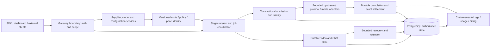

# Niu top-down project assessment

Baseline v1, 2026-10-12. Committed source inspected: `33ce4a59`; running native
implementation: `3fdc669c`, schema 0283. This is a rapid architectural and delivery
assessment using manifests, entry points, domain modules, current product/design
requirements, working-tree differences, retained scoped evidence and targeted
runtime reads. It is not a line-by-line security audit or a new full business run.

## Main conclusion

The project already contains the principal gateway business subsystems. Continue
with its modular monolith, existing PostgreSQL ledger and request coordinator.
The immediate problem is inconsistent delivery boundaries: scoped evidence is
spread across many documents, root contracts omit implemented methods, and
uncommitted route/SDK changes differ from both main and the running executable.
A rewrite or new microservice/extension framework is not justified by this audit.

The [fixed status board](project-status.md) is the delivery authority for this
baseline. It defines 14 subsystems: 12 backend/integration subsystems, one delegated
frontend/catalog/Help subsystem and one separate/deferred packaging/legacy scope.
The original assessment carried 11 of 36 fixed backend checkpoints. The current
status board records 26 accepted checkpoints and 10 remaining, with four of 12
backend subsystems closed (S01, S07, S09 and S11). These are scoped acceptance
counts, not coding percentage or complete release readiness. Chat closure covers
the backend SDK/contract handoff; frontend adoption and browser acceptance remain
separately delegated under S13.

The original native runtime is `8bfdef10`, schema 293. The isolated migration and
original upgrade preserve existing identities, configuration and business rows;
only operational recovery timestamps change. FastRouter now has an enabled,
unpriced personal Seedance 2.5 text preset under the existing personal owner.
The other three Seedance mappings remain disabled drafts. This is a personal
integration configuration, not commercial qualification or the complete model
control matrix.

A genuine documented Seedance 2.5 task has independently verified Gateway
recovery, result retrieval/full decode and restart. Genuine group and video
asset creation, Active refresh and verification-session encrypted persistence
also have bounded evidence. The corrected Niu asset-ID dispatch reaches
FastRouter once and records HTTP403 `permission_denied`, safe unknown state and
no-resend replay. Successful reference generation and priced media settlement
remain unverified; missing external entitlement is not invented as a platform
capability prerequisite. See [video reference evidence](../reference/provider-asset-video-current-acceptance.md).

The current public Chat SDK and exact draft contracts are handed off with actual
genuine-conversation save/conflict/reload/clear/restart evidence. Payment review
retains actual posted-charge refund evidence and explicitly discards fixture
merchant outcomes; genuine funding/callback verification remains open. No
fixture result contributes to a completion claim.

## Architecture and ownership

| Layer | Existing source boundary | Design rule |
| --- | --- | --- |
| Product surfaces | `apps/dashboard`, `apps/catalog`, `apps/docs`; marketing remains separately owned | Shared origin and brand; backend owns saved data. Rendered acceptance belongs to the frontend owner. |
| Public boundary | `apps/gateway/src/web`, management handlers, contracts and SDK | Authenticate/scope, parse declared contracts, project safe responses; no UI-only authorization. |
| Domain coordination | Gateway admission/inference/video/billing/Supplier modules | One owner for dispatch/retry, immutable bindings and explicit uncertainty; tools/task planning remain external. |
| Persistence and transactions | `crates/storage` and migrations | Authoritative scoped state, reservations, immutable history and exactly-once postings; preserve current database/encryption identities. |
| Transport and protocol facilities | `crates/upstream`, `crates/media`, selected vendor modules | Bounded network behavior and explicit capability coverage; adapters do not choose customer policy or post money. |
| Financial primitives | Storage billing, `crates/metered-cost`, `crates/payments` | Exact integer/rational amounts. Payment protocol verification does not itself credit funds. Floating estimates do not become ledger values. |
| Contracts and composition | `contracts`, JavaScript SDK, public/enterprise boundary | Community runtime has no private-source dependency. Existing extension traits are not proof of an active runtime extension host. |

## Common facilities to reuse and consolidate

These are already represented in the code; the task is to close their supported
behavior and integration, not implement duplicate systems.

1. **Identity and scoped authorization:** company/workspace/role/key lineage,
   management versus inference authority, member session and current revocation.
2. **Revisioned configuration:** Supplier credentials, model mapping, published
   routes, policy/tariff/offer identity; stale edits cannot silently overwrite.
3. **Durable request and job identity:** attempt certainty, response progress,
   usage confidence, settlement and actor-scoped idempotency remain independent.
4. **Admission and money:** reserve bounded liability, pin exact prices/accounts,
   settle/debit once and preserve uncertainty for recovery.
5. **Transport and protocol handling:** fixed credential headers, endpoint safety,
   bounded response/stream parsing, explicit errors and capability declarations.
6. **Persistence/recovery/retention:** saved Chat/video/assets, content-free
   deletion markers, restart recovery; content maintenance uses one extra bounded
   connection per process, not a global one-connection cap.
7. **Safe read models and contracts:** customer-only charges, unknown values,
   full-range reports, explicit API/SDK schemas and generated documentation.

New changes belong to these existing owners. Large files alone do not prove a
rewrite is necessary, but shared registration files need one integration owner:
committed management handlers are about 4,600 lines and the admin SDK about
2,546 lines. Introduce domain service seams through cohesive changes only when
needed by a demonstrated gap; do not spread the same transaction across layers.

## Concrete findings and disposition

| Finding | Authoritative observation | Disposition |
| --- | --- | --- |
| Main/runtime/worktree are different delivery states | Main `33ce4a59`; retained executable `3fdc669c`; targeted ready/registry/hash checks passed. Working tree includes independent route and SDK changes. | Record all three states; build/test agreed committed integration trees. Preserve unowned edits. |
| Workspace route migration is incomplete in the worktree | Main retains company-scoped compatibility routes; uncommitted edits remove them and change rename/delete to workspace-only routes. | S01-3/S11-2: coordinate the migration with frontend and publish compatibility explicitly before removing routes. |
| Gemini public route differs between main and pending edits | Main registers `/v1beta/models/{model_action}`; pending edits register `/v1/models/{model_action}`. | S03-2/S11-2: choose and document supported aliases with SDK/handler agreement; no silent route rename. |
| Root OpenAPI does not expose every selected registered method | The initial audit index covered 236 methods and recorded 20 method gaps; the [current gap ledger](backend-interface-gaps.md) records the integrated disposition. | S11-2: 15 management/detector methods, one media HEAD method, one browser callback classification and three excluded Codex methods have different dispositions. Do not turn all 20 into equally urgent feature work. |
| Runtime facilities exist and are operational, but this is limited evidence | Existing process ready; registry matches; schema 0283 and executable hash match the recorded refresh. Previous backup/identity evidence is retained. | Carry S12-1 with its explicit scope. No new release/throughput claim follows. |
| Payment support is broader than merchant activation | Current administrator inventory returns three integrations with separate checkout/configuration capability fields. | S06: supported capability is the gate. External merchant activation and cash receipt evidence are separate; no fabricated funding. |
| Personal video and paid media have different evidence | Actual personal artifacts/recovery exist; the exercised upstream report lacks billable quantity. | S08/S05: retain unknown quantity. Close implemented meter/settlement capability separately; do not infer billable duration or make commercial claims. |
| Deprecated product concepts remain in dependencies/routes | Gateway depends on benchmark/execution compatibility packages; a benchmark route and Codex-connection routes are still registered. | S14: coordinate the scoped removal backlog separately; do not expand task orchestration, quota pooling or Agent Observability. |
| CI is static scope | Current baseline contract, docs and backend-static workflows completed successfully. | Record compilation/contract delivery separately from real business acceptance; fixture outcomes have zero signal. |

Public and privately tracked issues were inventoried. Advisory feedback remains
below the owner's priority and does not automatically add acceptance items.
Private issue content/references are not copied here. Packaging, rendered UI,
marketing and external Agent Observability retain their existing ownership.

## Implementation dependencies and parallel lanes

The dependency graph in the status JSON is a dependency on stable interfaces,
not a rule to wait for every predecessor's full subsystem acceptance before
writing code. Existing implementations let lanes proceed concurrently after
shared boundaries and contract changes are agreed.

| Lane | Owned subsystems | Output | Files requiring integration coordination |
| --- | --- | --- | --- |
| A — access and configuration | S01, S02, S04, S10 | Scoped management/policy/configuration services and exact contracts | `admin.rs`, routes, storage exports, shared schemas |
| B — inference and finance | S03, S05, S06 | Protocol matrix, durable admission/settlement and payment capability | Coordinator/admission, financial transaction interfaces, migrations |
| C — durable data and diagnostics | S07, S08, S09 | Request read models, video/asset lifecycle, durable Chat | Saved-state schemas, common response projection, media settlement interface |
| I — integration owner | S11, S12 | Contract/SDK publication, migration ordering, integrated business evidence, performance | Sole publisher for shared routes/contracts/generated artifacts and migration allocation |
| Separate frontend owner | S13 | Dashboard/catalog/Help integration and browser acceptance | Consume the versioned contract; coordinate API changes before integration |

Assign isolated worktrees and stopped/copy-safe disposable databases to concurrent
implementation tasks. Publish tested increments to main through lane I. One
writer owns each shared file; one owner allocates migrations. Do not let parallel
workers modify the original database, encrypting identity or each other's files.
No implementation workers were started by this assessment.

## Finite delivery order

1. **D0 — design/status baseline:** this assessment and fixed source-of-truth
   board. The previous serial audit plan is superseded by this version.
2. **D1 — integration/common facility gaps:** agree pending route changes, close
   required contract/SDK gaps and assign the existing common service owners.
   Avoid blanket endpoint reimplementation.
3. **D2 — parallel subsystem closure:** lanes A/B/C complete the stable open
   checkpoint IDs. Reuse valid unchanged evidence, rerun changed or missing
   paths, and publish complete subsystem increments.
4. **D3 — integrated acceptance:** the same supported application journey crosses
   Supplier → key → inference → charges → reports and the supported video/Chat
   lifecycle; independent data/artifact checks prove the final state.
5. **D4 — performance and handoff:** after relevant business gates close, measure
   increasing/mixed load and overload recovery with exact accounting. No New API
   superiority claim without an actual comparable measurement.

Update task evidence/status rather than writing a new plan for every finding.
Only contrary actual evidence reopens a completed checkpoint. New owner requests
get explicit IDs and a versioned scope change. A subsystem closes only when all
its fixed checkpoints close. External activation cannot silently become a gate.
The assessment goal ends with publication of these artifacts; implementing this
plan is a separate explicitly tracked goal.
