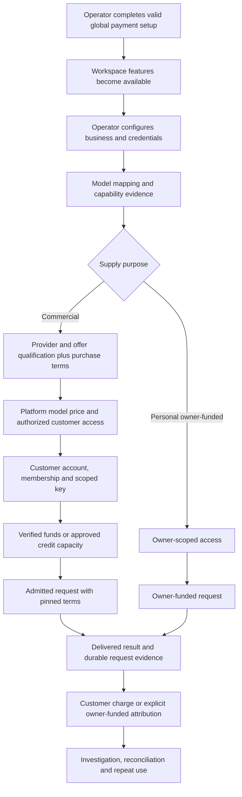

# Niu product blueprint for UX review

Review date: 2026-10-20. Status: review interpretation, not a newly approved product specification. Baseline: working tree based on `241872d0`; concurrent uncommitted work exists. Revalidate observations against later changes.

## Authority and intended value

[Product focus](../product/product-focus.md) defines Niu as a product for operators running model aggregation businesses. Its combined promise is reliable model delivery, clear financial accounting, and convenient, secure customer access. A successful owner-funded demonstration is useful evidence but does not establish commercial readiness.

The [release matrix](../releases/first-release.md) defines required capabilities and explicitly marks every F01–F10 gate partial. [Repository ownership](../architecture/repository-ownership.md) separates the public product from marketing, private plugins and external orchestration. Current repository/user instructions supersede older terminology and implementation workflows: use Provider and workspace, preserve current shared primitives, and do not reintroduce a mandatory design-generation step. Earlier Supplier URLs or historical task-economics documents are not current design requirements.

### Pricing clarification — 2026-10-20

Following user review of UX-01, platform-wide model selling prices are the default. Workspaces own access, limits and usage attribution, not separate prices or standard-price enrollment. Existing scoped APIs are implementation evidence, not a requirement to preserve that product model. Exceptional customer contracts or discounts require an explicit business need. Changes to stored terms and historical charges need a separate migration design.

### Payment prerequisite clarification — 2026-10-20

The user requires valid global payment setup before any workspace feature becomes available. This applies across workspaces, including personal-key usage; balance or credit is not an exemption. Keep administrator setup and necessary authentication/recovery available. Use server-authoritative operational readiness, not configuration presence alone. Individual failed payments remain distinct from installation readiness. Preserve in-flight settlement and stored records when enforcing the gate.

### Goals

| ID | Actor and outcome | Product basis |
| --- | --- | --- |
| G1 | Operator prepares authorized, usable model supply and can understand why a route is or is not ready. | Product focus; F03/F04/F07 |
| G2 | Operator makes an explicit commercial offer available to the correct customer, with sustainable, traceable pricing. | Product focus; F05/F07 |
| G3 | Customer obtains access, understands available models and prices, funds shared capacity where needed, and makes a first successful request. | Product focus; F02/F03/F05 |
| G4 | Customer produces and retrieves durable text/video results within supported capabilities and account constraints. | Generations direction; F04/F09 |
| G5 | Operator and customer diagnose delivery and charges using appropriate, isolated evidence. | Product focus; F05/F06/F08 |
| G6 | Operator manages access, policies, deployment configuration and recoverable operations without losing customer continuity. | F01/F02/F09/F10 |

Niu owns model request delivery and its accounting, not external agent planning, task acceptance, subscription optimization or external tool telemetry. Provider-native media support can belong when necessary for supported generation; its existence alone does not justify a separate top-level destination. Internal APIs may support valid mechanisms without needing a customer UI.

## Actors and ownership

| Actor | Responsibility | Boundary |
| --- | --- | --- |
| Installation operator | Supply, commercial qualification, customer tariffs, merchant configuration, financial exposure and support | Procurement and margins remain confidential |
| Company owner/admin | Shared customer funds and authorized workspace administration | Workspace limits do not create separate company balances |
| Workspace member/application | Scoped keys, generation, usage and permitted policy operations | Membership does not imply installation or company-wide financial authority |
| Provider representative | Own agreed offers, usage, earnings and payment records | Portal membership does not connect upstream credentials |
| Personal upstream-key owner | Isolated owner-funded testing | Not commercial qualification or customer prepaid charging |
| External merchant/upstream | Payment or model-service outcomes and evidence | Integration support is distinct from activated, qualified service |

## Value-delivery paths

The payment-readiness edge is a mandatory workspace-entry prerequisite. Other edges describe dependencies, not a rigid order for independent administrator setup actions. Video adds estimation, asynchronous state/recovery and artifact retrieval to the request lifecycle. Guards and access checks span both paths. A commercial failure must not be “resolved” by silently moving the user onto personal supply.

## Capability map and review stance

| Capability | Intended responsibility | Review test |
| --- | --- | --- |
| Provider administration | Business identity, credentials, routes, qualification and procurement | Can the operator distinguish connection readiness from commercial readiness and follow the missing prerequisite? |
| Pricing and customer access | Platform model selling prices; separate access and supply qualification | Can an authorized customer use the applicable price without per-workspace price configuration or enrollment? |
| Workspaces and keys | Scoped application access, limits and attribution | Can the customer get from account membership to a usable key and correct client example? |
| Company Billing/Payments | Shared capacity, funding and recovery | Can the customer discover funds from a blocked request and complete or escalate funding? |
| Generations | Saved Chat/Video sessions and useful outputs | Is generation accessible without knowing internal route or task identifiers, and can results be revisited? |
| Logs/Activity | Evidence and investigation of handled requests | Do summaries lead to the relevant requests and an actionable diagnosis? |
| Guardrails | Explicit supported restrictions and inspection | Can the administrator understand scope, coverage, activation and recovery without imagining external tool control? |
| Platform configuration | Supported installation-wide settings | Do controls reflect actual capability and explain configuration ownership? |
| APIs/SDK/docs | Same supported access and lifecycle outside the dashboard | Are documented goals possible without undocumented operator knowledge? |

Do not retire these capabilities merely because the current UI is awkward. Evaluate proposed consolidation or retirement against the goal and actual dependencies. See findings for narrower, evidence-based recommendations.

## Journeys to inspect

- J1 / G1: connect independent supply, map models, identify readiness and next steps.
- J2 / G2: qualify commercial supply, establish a customer price and make the model usable by a selected workspace.
- J3 / G3: obtain customer membership, create a scoped key, find a suitable priced model and its client setup.
- J4 / G3: establish valid global payment setup before workspace access; then identify customer capacity, fund or obtain authorized credit, and resume use.
- J5 / G4: start/continue generation, retrieve saved results and recover from unsupported/uncertain states.
- J6 / G5: investigate a request and reconcile its state, usage and customer charge without procurement disclosure.
- J7 / G6: configure scope-appropriate policy, interpret a denial and restore permissible use.
- J8 / G6: administer supported platform settings, access and deployment lifecycle.

Review-only execution can verify discovery and existing-result reads. New access, financial activation, generation submissions and destructive changes remain outside this run; do not convert unexecuted transitions into passes.
